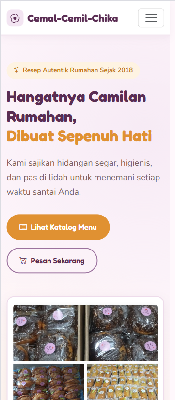
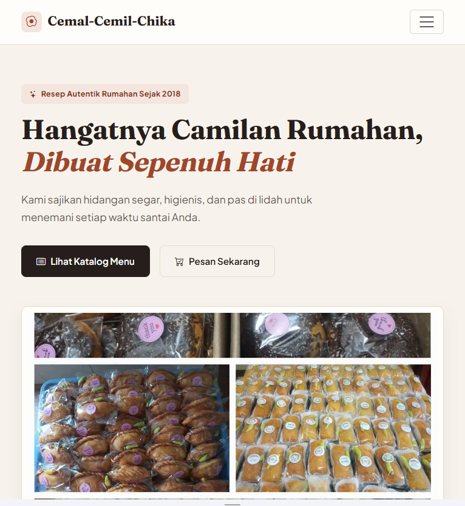
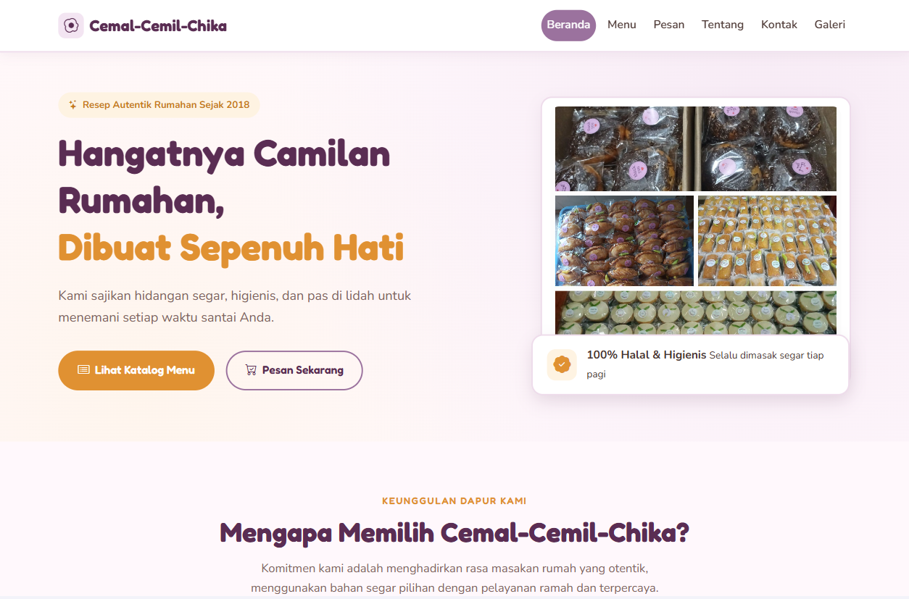
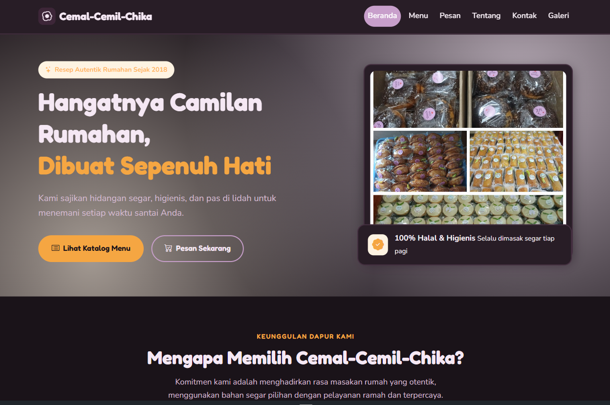

# Cemal-Cemil-Chika — Proyek UTS Pemrograman Antarmuka Web

Situs web multi-halaman untuk **Cemal-Cemil-Chika**, sebuah usaha kuliner rumahan lokal (UMKM) di Surabaya yang menyajikan aneka camilan gurih, kue basah tradisional, dan paket katering snack box. Dibangun menggunakan HTML5 semantik, CSS murni (Flexbox, CSS Grid, Responsive Mobile-First, Dark Mode), dan framework Bootstrap 5.3 tanpa JavaScript buatan sendiri.

- **Tautan Repositori GitHub:** [https://github.com/koichi687/uts-paw-v-cemal-cemil-chika](https://github.com/koichi687/uts-paw-v-cemal-cemil-chika)
- **Tautan GitHub Pages:** [https://koichi687.github.io/uts-paw-v-cemal-cemil-chika/](https://koichi687.github.io/uts-paw-v-cemal-cemil-chika/)
- **Kelas:** V — S1 Teknik Informatika, ITATS

---

## 1. Informasi Usaha & Target Pengguna
- **Sub-tema:** 1. Kedai kopi / warung makan
- **Nama Usaha:** Cemal-Cemil-Chika
- **Target Pengguna:** Mahasiswa kampus sekitar, pekerja kantoran, serta keluarga di Surabaya yang membutuhkan camilan harian, stok *frozen food* higienis, maupun pesanan *snack box* dan katering untuk berbagai acara formal maupun santai.

---

## 2. Anggota Kelompok & Pembagian Halaman

| No | NPM | Nama Lengkap | Akun GitHub | Halaman yang Dikerjakan |
| :---: | :---: | :--- | :---: | :--- |
| 1 (Ketua) | 06.2025.1.07854 | Muhammad Farel Eka Saputra | `@koichi687` | `about.html`, `image.html` |
| 2 | 06.2025.1.07859 | Reno Alviansyah Kharel | `@rnalvnsyh` | `pesan.html`, `contact.html`, `terima-kasih.html` |
| 3 | 06.2025.1.07860 | Muhammad Aquillah Putera Maheswara | `@mahheswaraa` | `index.html`, `menu.html` |

---

## 3. Sitemap & Deskripsi Halaman

```text
index.html (P1: Beranda)
├── menu.html (P2: Katalog Menu & Tabel Harga Resmi)
├── pesan.html (P3: Formulir Pemesanan & Reservasi Katering)
│   └── terima-kasih.html (Konfirmasi Penerimaan Form & Ringkasan URL)
├── about.html (P4: Profil Usaha, Tim & FAQ Interaktif)
├── contact.html (P4: Informasi Kontak & Layanan Pelanggan)
└── image.html (P5: Galeri Dokumentasi Dapur & Momen Orderan Ramai)
```

---

## 4. Desain Tata Letak & Token CSS (C2, D2, D3)

### A. Tabel Token Custom Property (`:root`)
Seluruh warna dan variabel desain diatur terpusat di `:root` pada file `css/style.css`:

| Token CSS | Nilai Awal (Mode Terang) | Nilai Mode Gelap | Fungsi / Penerapan |
| :--- | :---: | :---: | :--- |
| `--bg-page` | `#FFF8FC` | `#1A1319` | Warna latar belakang utama halaman |
| `--surface` | `#FFFFFF` | `#281D26` | Warna latar kartu, navbar, dan kontainer |
| `--primary` | `#9B729E` | `#C89FCB` | Warna ungu utama (tombol aktif, border fokus) |
| `--primary-dark` | `#5A2D53` | `#F5E8F4` | Warna teks judul `<h1>`–`<h6>` & navbar brand |
| `--primary-soft` | `#F3E5F2` | `#3D2638` | Warna latar badge dan aksen lembut |
| `--accent` | `#E09132` | `#F5A642` | Warna emas karamel untuk tombol CTA dan badge |
| `--accent-hover` | `#C87A1E` | `#FFB75E` | Efek hover tombol CTA |
| `--text-main` | `#4A3531` | `#F7EEF5` | Warna teks paragraf dan konten utama |
| `--text-muted` | `#7D6460` | `#D1BACD` | Warna teks keterangan sekunder dan tanggal |
| `--border-soft` | `#EEDCEB` | `#442F40` | Garis tepi kartu dan pemisah navigasi |
| `--shadow-soft` | `rgba(90, 45, 83, 0.08)` | `rgba(0, 0, 0, 0.45)` | Bayangan lembut kartu konten |
| `--radius` | `16px` | `16px` | Sudut lengkung kartu dan kontainer |

### B. Tabel Breakpoint Responsif (D2)
| Breakpoint | Ukuran (`em` / `px`) | Perubahan Tata Letak |
| :---: | :---: | :--- |
| **Mobile (Dasar)** | `< 48em` (< 768px) | 1 Kolom vertikal, navbar hamburger collapse, hero teks di tengah |
| **Tablet** | `48em` (768px) | Grid 2 Kolom untuk kartu menu, timeline sejajar |
| **Desktop** | `62em` (992px) | Grid 3–4 Kolom penuh, navbar horizontal terbuka penuh |

---

## 5. Framework CSS vs CSS Murni (E4)
- **Framework yang Dipilih:** Bootstrap 5.3 (via CDN).
- **Pembagian Penggunaan:**
  - **Bootstrap 5.3:** Digunakan untuk sistem grid responsif (`container`, `row`, `col-*`), utilitas flexbox (`d-flex`, `align-items-center`), serta interaktivitas navbar hamburger (`collapse`) melalui `bootstrap.bundle.min.js`.
  - **CSS Murni (`css/style.css`):** Digunakan untuk palet warna `:root`, dark mode otomatis (`prefers-color-scheme: dark`), tipografi fluid `clamp()`, layout grid area (`grid-template-areas`), efek zoom gambar kartu menu (`.food-avatar`), serta penyesuaian khusus form dan tombol.

### Perbandingan Komponen: Kartu Menu (`menu-card`)
- **Implementasi Framework:** Menggunakan `.card` bawaan Bootstrap menghasilkan padding dan border abu-abu standar yang kaku.
- **Implementasi CSS Murni:** Komponen `.menu-card` kami buat sendiri menggunakan kombinasi `display: flex`, `border-radius: var(--radius)`, `overflow: hidden`, dan efek animasi `.food-avatar:hover` (`transform: scale(1.08)`).
- **Alasan Pemilihan:** Memberikan identitas visual yang otentik dan hangat khas kuliner rumahan, tanpa terlihat seperti template bawaan framework biasa.

---

## 6. Pengujian & Tangkapan Layar (G4)

### A. Tangkapan Layar Responsif & Mode Gelap
*(Silakan simpan foto tangkapan layar ke folder `img/screenshots/`)*

| Layar Mobile (360px) | Layar Tablet (768px) |
| :---: | :---: |
|  |  |

| Layar Desktop (1280px) | Mode Gelap (Dark Mode) |
| :---: | :---: |
|  |  |

### B. Hasil Audit & Aksesibilitas
- **W3C Markup Validator:** 0 Error di seluruh 7 halaman HTML.
- **Skor Lighthouse Accessibility:** ≥ 90 di seluruh halaman utama.
- **Uji Navigasi Keyboard:** Situs dapat dijelajahi penuh hanya dengan tombol `Tab`, `Enter`, dan `Space`, didukung skip link *"Lewati ke konten utama"* serta indikator fokus keyboard (`:focus-visible`).

---

## 7. Sumber Aset & Pernyataan Penggunaan AI
- **Sumber Gambar:** Seluruh dokumentasi makanan dan dapur adalah **foto asli** dari usaha kuliner Cemal-Cemil-Chika (dokumen pribadi UMKM dengan izin pemilik).
- **Sumber Ikon:** Menggunakan *Bootstrap Icons v1.11.3* (lisensi MIT).
- **Penggunaan AI:** Menggunakan bantuan asisten AI (Antigravity / Gemini) sebagai rekan diskusi teknis untuk meninjau kepatuhan spesifikasi teknis tugas UTS, menyusun kerangka semantik HTML5, memverifikasi aksesibilitas (ARIA/WCAG).